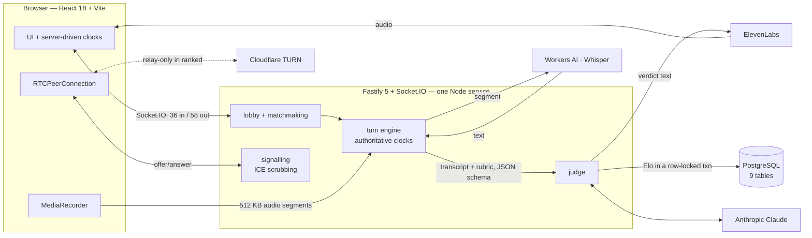

# YapStage

A live 1v1 spoken debate platform. Two people (or a person and an AI opponent) are dealt a
random motion and a side by coin flip, argue it out loud over a WebRTC call in eight timed
turns, and an LLM judge scores the transcript, picks a winner, quotes each player's best line
and coaches them afterwards. There is an Elo ladder on top.

The interesting engineering problem is not the video call — it is making the judge defensible.
An LLM asked "who won this debate" is swayed by which side it reads first, by confident tone,
by polish, and by anything a debater says directly to it. Most of the work below is about
measuring that and driving it down.

**Live: <https://www.yapstage.com>** — no install needed; "play bots" works without an account.


## How a match works

1. **Lobby.** You pick a mode (ranked, bots, a friend by code, spectate, or a 30-second daily
   drill). The server deals a motion from a pool of 56 and flips a coin for your side, so you
   routinely have to argue the position you don't hold.
2. **The call.** WebRTC audio/video peer-to-peer. Ranked matches are audio-only behind drawn
   character masks, and forced relay-only so two strangers never learn each other's IP address.
3. **Eight turns, four rounds.** Openings, rebuttals, defenses, closings — 45/45/35/25 seconds
   at standard pace, about five minutes end to end. Speaking order mirrors at the halfway point
   so each side leads twice, and FOR keeps both bookends. Clocks live on the server; the client
   only renders them. Your mic is muted unless it is your turn.
4. **Transcription.** The client records with `MediaRecorder` and uploads 512 KB-capped
   segments; the server runs them through Whisper (`large-v3-turbo`) on Cloudflare Workers AI
   and assembles a per-turn transcript. Server-side STT means Safari and mobile work, not just
   Chrome's built-in speech API.
5. **The verdict.** The full transcript goes to Claude with a four-part rubric under a JSON
   schema. The judge writes private point-by-point analysis *before* it is allowed to score.
   The verdict comes back in about 20 seconds, is read aloud by ElevenLabs to both players and
   any spectators, and the Elo delta is applied in a row-locked PostgreSQL transaction.


## Architecture



One Node process serves both the API and the built client, so production is a single Docker
image on Railway with a managed PostgreSQL beside it; push to main deploys. Client and server
import the same `protocol.ts`, so the two sides cannot disagree about message shapes — 58
server-to-client event types and 36 inbound handlers all come from one file.

The dependency list is deliberately short: six production dependencies on the server
(Fastify, `@fastify/static`, Socket.IO, `pg`, the Anthropic SDK, dotenv) and three on the
client (React, React DOM, the Socket.IO client). No ORM, no auth library, no component or
state library, no test framework. Google OAuth, the SQL layer and migrations, rate limiting,
the Elo maths, the test runner and ~10k lines of CSS are hand-written. The UI ships English
and Arabic, including RTL layout.

PostgreSQL is optional at boot: without `DATABASE_URL` the app still runs matches and judges
them, it just keeps nothing.

## The parts worth reading

| File | Why |
|---|---|
| [`server/src/debate.ts`](server/src/debate.ts) | The turn engine. The 8-step script and why the rounds are shaped that way, server-authoritative clocks, pass-the-mic, reconnect and resume, grace windows. |
| [`server/src/judge.ts`](server/src/judge.ts) | The judge: rubric (argument 30 / evidence 20 / clash 30 / delivery 20), the JSON schema, the "write your analysis before you score" rule, the swap test, how unexplained statistics and prompt-injection attempts are handled. |
| [`scripts/judge-fairness.mjs`](scripts/judge-fairness.mjs) | Replays every case three ways — as written, sides swapped under a negated motion, speaking order flipped — and tracks speeches by identity rather than by label. |
| [`server/src/security.ts`](server/src/security.ts) | `relayOnlySignal()` strips every non-relay ICE candidate and zeroes the `raddr`/`rport` pairs and the SDP default address, so a ranked match cannot leak either peer's IP. |
| [`server/src/bots.ts`](server/src/bots.ts) + [`docs/CALIBRATION.md`](docs/CALIBRATION.md) | Eight opponents from 200 to 3000, 400 apart, and the harness that measures whether the ladder is real. |
| [`server/src/protocol.ts`](server/src/protocol.ts) | The shared wire contract. |
| [`server/src/store.ts`](server/src/store.ts) | Hand-written SQL, nine boot-time migrations, the row-locked rating transaction. |

## How the judge is evaluated

This is the part I would want a reviewer to look at. The rule is that no judge prompt change
ships until the suite passes, and every number below is a real run against the production
model, logged in [`docs/judge-tightening-log.md`](docs/judge-tightening-log.md).

The cases are hand-built debates with a deliberately stronger side, including ideologically
charged ones where the better-argued side is the unpopular one.

| Suite | Result |
|---|---|
| Accuracy — does it pick the side built to argue better? | 15/15 |
| Agreement with an independent blind human reader | 16/16 |
| Charged political cases (rewards the well-argued unpopular side) | 5/5 |
| Adversarial suite | 10/10, with injection flagged correctly 6/6 and no false alarms |
| Fairness replays (131 judge calls) | winner flips 2/41 under side swap and 3/45 under order flip — **0 of those were decisive** |
| Label bias per speech | 1.4 points, down from 2.4 at baseline |
| Side balance across the suite | FOR won 9, AGAINST won 9 |

For scale: replaying identical transcripts puts the judge's run-to-run noise floor at about
8 points of margin, so a residual 1.4-point label bias sits inside the noise. The sample is
small — 50 hand-built cases (18 core, 27 bias families, 5 adversarial), each also scored
mirrored where the motion has a written negation — and I would not claim the judge is
accurate in general, only that it is measured.

Re-running it needs a server in fast mode, which opens the test-only `/judge-eval` endpoint:

```sh
DEBATE_SPEED=fast node server/dist/index.js        # fast mode refuses to start in production

URL=http://localhost:3000 CASES=scripts/judge-cases.json MIRROR=1 node scripts/judge-eval.mjs
URL=http://localhost:3000 node scripts/judge-fairness.mjs
node scripts/judge-noise.mjs runA.json runB.json   # the noise floor, from repeated runs
```

These call the real model and cost real money — the 131-call fairness run was $5.24. Point
them at the mock below if you only want to check the harness runs.

## Running it locally

There is no `npm install && npm start` that gives you the whole product: judging, speech and
voices are third-party services. The honest version is that **everything is env-gated and
degrades instead of crashing**, so you can get quite far with nothing.

```sh
npm install
cp .env.example .env     # every value may stay blank to start

npm run dev:server       # :3000
npm run dev:client       # :5173, proxies /socket.io to :3000
```

Open <http://localhost:5173> in two tabs and debate yourself. Set `DEBATE_SPEED=fast` for
~30-second debates.

**To run without spending anything**, there is a stand-in for the Anthropic Messages API that
synthesises a response from whatever JSON schema the request asks for, so judge, bot and
coach flows all complete with placeholder text:

```sh
node scripts/mock-anthropic.mjs                                     # :3099
ANTHROPIC_BASE_URL=http://localhost:3099 ANTHROPIC_API_KEY=mock \
  DEBATE_SPEED=fast node server/dist/index.js
```

What each key buys you, all optional:

| Variable | Without it |
|---|---|
| `ANTHROPIC_API_KEY` | No verdicts, no bot opponents, no coach. Use the mock above. |
| `CF_ACCOUNT_ID`, `CF_AI_API_TOKEN` | Falls back to the browser's speech API — Chrome only, and weak on Arabic. |
| `CF_TURN_KEY_ID`, `CF_TURN_API_TOKEN` | Calls work on a friendly network, fail behind strict NATs. Ranked's relay-only privacy guarantee needs these. |
| `ELEVENLABS_API_KEY` | Bots and verdicts are silent; text still appears. |
| `GOOGLE_CLIENT_ID`, `GOOGLE_CLIENT_SECRET` | Sign-in is hidden; everyone plays as a guest, so no ranked and no saved history. |
| `DATABASE_URL` | Matches run and are judged, nothing is stored. |
| `SESSION_SECRET`, `STATS_KEY`, `LLM_HOURLY_CAP` | Session signing, the keyed `/stats` endpoint, and the hourly spend cap. |

`.env.example` documents the first few; the full list above is the one the server actually
reads.

## Tests

434 assertions pass on the current build, in three suites, run against a local server in fast
mode. There is no framework — each script is a plain Node file with a `check()` function — and
there is no coverage measurement, so "434 checks" is a count of assertions and nothing more.

```sh
URL=http://localhost:3000 node scripts/smoke.mjs        # 234 end-to-end protocol checks
URL=http://localhost:3000 node scripts/smoke-edge.mjs   #  20 edge cases
node scripts/security-unit.mjs                          # 180 security and unit checks
```

`smoke.mjs` drives the server with real Socket.IO clients through whole matches. Beyond these,
a browser harness runs up to four headless Chrome instances over the DevTools Protocol with
synthesised speech files standing in for microphones, and a TCP proxy that injects connection
resets and stalls, which is how the reconnect paths get exercised.

## Repo layout

```
client/src/        React 18 + Vite. screens/, hand-written CSS, inline-SVG characters,
                   English + Arabic with RTL.
server/src/        24 modules. debate.ts (turn engine), judge.ts, store.ts (SQL +
                   migrations), auth.ts (Google OAuth, hand-rolled), security.ts,
                   bots.ts, stt.ts, tts.ts, turn.ts, protocol.ts (shared with the client).
scripts/           Test suites, the judge eval/fairness/noise harnesses and their case
                   files, the bot-ladder harness, the Anthropic mock, the screenshot tool.
docs/              Judge tuning log and bot calibration methodology — the raw runs behind
                   the numbers above.
Dockerfile         One image: the Fastify server serves the built client.
```

## Limitations, and what is deliberately not done

- **The judge's sample is small.** 50 hand-built cases is enough to catch a regression, not
  enough to claim general accuracy.
- **No usage numbers here.** The site has been publicly deployed since September 2026 and the
  database was wiped to zero at launch. I am not going to invent traffic for a README.
- **Every match costs money** — about $0.08–0.12 for a human match and $0.25–0.80 against a
  bot, with voice synthesis the bulk of it. There is an hourly model-call cap, a circuit
  breaker, one live seat per player and per-address room limits, but the economics do not
  work at scale as built.
- **Capacity limits are configured, not load-tested.** 100 spectators per match and 500
  lobbies are ceilings in the code; I have not driven that much traffic through it.
- **No CI.** Deploys are push-to-main and the suites are run by hand before pushing. A real
  team would gate this.
- **Single region, single process.** Lobby state is in memory, so the server does not scale
  horizontally without moving that out.
- **No mobile apps and no tournaments.** Typed speech is blocked in ranked whenever
  server-side transcription is available, because typed text reads differently to the judge
  than transcribed speech; friend and bot games keep it.
