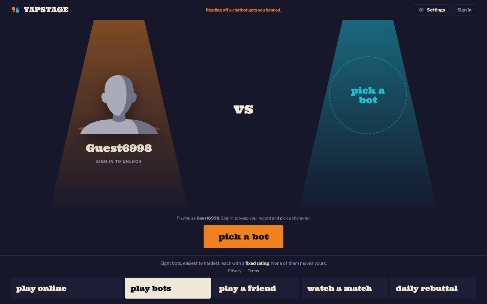
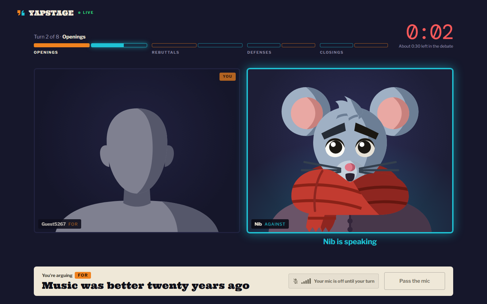
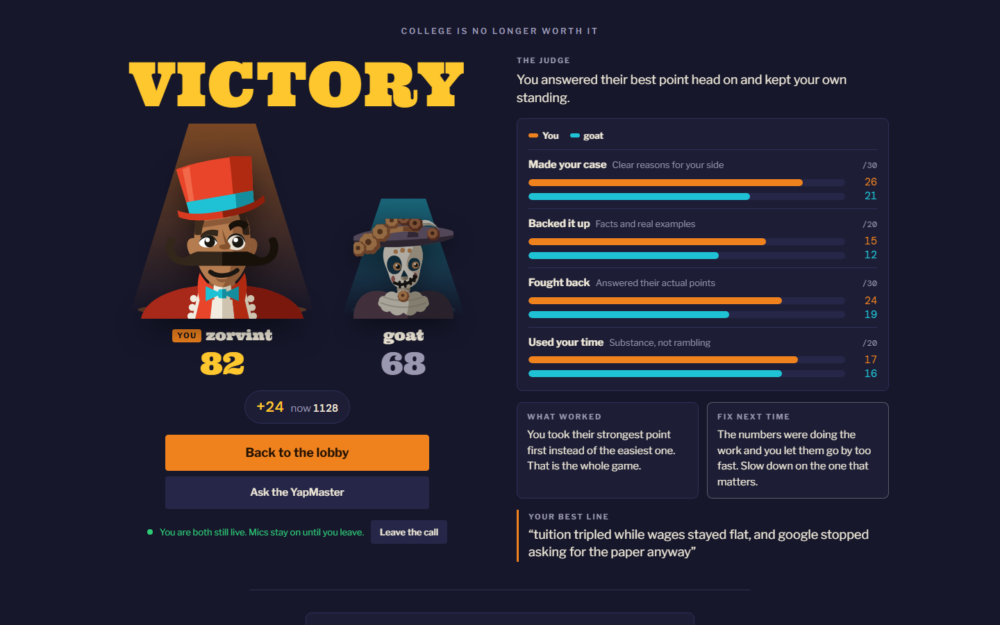
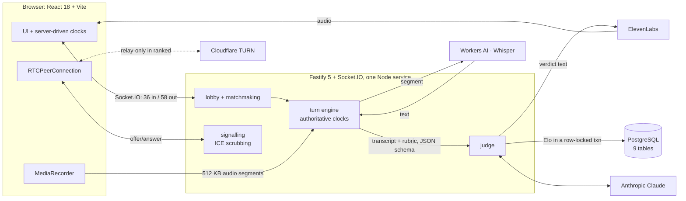

# YapStage

A live 1v1 spoken debate platform. Two people (or a person and an AI opponent) are dealt a
random motion and a side by coin flip, argue it out loud over a WebRTC call in eight timed
turns, and an LLM judge scores the transcript, picks a winner, quotes each player's best line
and coaches them afterwards. An Elo ladder sits on top.

**Live at <https://www.yapstage.com>.** No install needed, and "play bots" works without an
account. Since launching in September 2026 it has judged 1,753 debates for 811 players.

The hard engineering problem is making the judge defensible. An LLM asked "who won this
debate" is swayed by which side it reads first, by confident tone, by polish, and by anything
a debater says directly to it. Most of the work below is about measuring that and driving it
down.



## How a match works

1. **Lobby.** Pick a mode: ranked, bots, a friend by code, spectate, or a 30-second daily
   drill. The server deals a motion from a pool of 56 and flips a coin for your side, so you
   often argue the position you don't hold.
2. **The call.** Peer-to-peer WebRTC audio and video. Ranked matches are audio-only behind
   drawn character masks, and forced relay-only so two strangers never learn each other's IP
   address.
3. **Eight turns, four rounds.** Openings, rebuttals, defenses, closings: 45/45/35/25 seconds,
   about five minutes end to end. Speaking order mirrors at the halfway point so each side
   leads twice. Clocks live on the server and the client only renders them. Your mic is muted
   unless it is your turn.
4. **Transcription.** The client records with `MediaRecorder` and uploads 512 KB segments. The
   server runs them through Whisper (`large-v3-turbo`) on Cloudflare Workers AI and assembles
   a per-turn transcript, so Safari and mobile work, not just Chrome.
5. **The verdict.** The transcript goes to Claude with a four-part rubric under a JSON schema.
   The judge has to write its point-by-point analysis before it is allowed to score. The
   verdict arrives in about 20 seconds, is read aloud by ElevenLabs to both players and any
   spectators, and the Elo change is applied in a row-locked PostgreSQL transaction.





## Architecture



One Node process serves the API and the built client, deployed as a single Docker image on
Railway with managed PostgreSQL beside it. Client and server import the same `protocol.ts`, so
all 58 server-to-client events and 36 inbound handlers come from one typed contract.

The server has six production dependencies (Fastify, `@fastify/static`, Socket.IO, `pg`, the
Anthropic SDK, dotenv) and the client has three (React, React DOM, the Socket.IO client). Google
OAuth, the SQL layer and migrations, rate limiting, the Elo maths and the test runner are
written by hand. The UI ships in English and Arabic, including right-to-left layout.

## Where to start reading

| File | Why |
|---|---|
| [`server/src/debate.ts`](server/src/debate.ts) | The turn engine: the 8-step script, server-authoritative clocks, pass-the-mic, reconnect and resume. |
| [`server/src/judge.ts`](server/src/judge.ts) | The judge: rubric (argument 30 / evidence 20 / clash 30 / delivery 20), JSON schema, analysis-before-score, and handling of unsupported statistics and prompt injection. |
| [`scripts/judge-fairness.mjs`](scripts/judge-fairness.mjs) | Replays every case as written, with sides swapped under a negated motion, and with speaking order flipped. |
| [`server/src/security.ts`](server/src/security.ts) | `relayOnlySignal()` strips every non-relay ICE candidate and the addresses inside them, so a ranked match cannot leak either player's IP. |
| [`server/src/bots.ts`](server/src/bots.ts) + [`docs/CALIBRATION.md`](docs/CALIBRATION.md) | Eight AI opponents from 200 to 3000 Elo, and the harness that calibrates them. |
| [`server/src/protocol.ts`](server/src/protocol.ts) | The shared wire contract. |
| [`server/src/store.ts`](server/src/store.ts) | Hand-written SQL, boot-time migrations, the row-locked rating transaction. |

## Judge evaluation

No judge prompt change ships until the suite passes. Every number below is a run against the
production model, logged in [`docs/judge-tightening-log.md`](docs/judge-tightening-log.md). The
cases are hand-built debates with a deliberately stronger side, including politically charged
ones where the better-argued side is the unpopular one.

| Suite | Result |
|---|---|
| Accuracy: picks the side built to argue better | 15/15 |
| Agreement with a blind human reader | 16/16 |
| Charged political cases | 5/5 |
| Adversarial suite | 10/10, prompt injection flagged 6/6 with no false alarms |
| Side- and order-swapped replays (131 judge calls) | 0 decisive winner flips |
| Label bias per speech | 1.4 points, down from 2.4 |
| Side balance | FOR won 9, AGAINST won 9 |

Repeated runs on identical transcripts put the judge's noise floor at about 8 points of
margin, so the remaining 1.4-point label bias is inside the noise.

To re-run it, start the server in fast mode, which opens a test-only `/judge-eval` endpoint:

```sh
DEBATE_SPEED=fast node server/dist/index.js        # fast mode refuses to start in production

URL=http://localhost:3000 CASES=scripts/judge-cases.json MIRROR=1 node scripts/judge-eval.mjs
URL=http://localhost:3000 node scripts/judge-fairness.mjs
node scripts/judge-noise.mjs runA.json runB.json   # noise floor from repeated runs
```

These call the real model. Point them at the mock below to check the harness for free.

## Running locally

Every external service is optional and the app degrades instead of crashing without it.

```sh
npm install
cp .env.example .env     # every value may stay blank to start

npm run dev:server       # :3000
npm run dev:client       # :5173, proxies /socket.io to :3000
```

Open <http://localhost:5173> in two tabs and debate yourself. Set `DEBATE_SPEED=fast` for
30-second debates.

To run without any API spend, a mock of the Anthropic Messages API builds a response from
whatever JSON schema the request asks for, so judge, bot and coach flows all complete:

```sh
node scripts/mock-anthropic.mjs                                     # :3099
ANTHROPIC_BASE_URL=http://localhost:3099 ANTHROPIC_API_KEY=mock \
  DEBATE_SPEED=fast node server/dist/index.js
```

| Variable | Without it |
|---|---|
| `ANTHROPIC_API_KEY` | No verdicts, bots or coach. Use the mock above. |
| `CF_ACCOUNT_ID`, `CF_AI_API_TOKEN` | Falls back to the browser's speech API (Chrome only). |
| `CF_TURN_KEY_ID`, `CF_TURN_API_TOKEN` | Calls fail behind strict NATs, and ranked's relay-only mode is off. |
| `ELEVENLABS_API_KEY` | Bots and verdicts are text only. |
| `GOOGLE_CLIENT_ID`, `GOOGLE_CLIENT_SECRET` | Everyone plays as a guest: no ranked, no saved history. |
| `DATABASE_URL` | Matches run and are judged, nothing is stored. |
| `SESSION_SECRET`, `STATS_KEY`, `LLM_HOURLY_CAP` | Session signing, the keyed `/stats` endpoint, the hourly model-call cap. |

## Tests

434 assertions across three suites, run against a local server in fast mode:

```sh
URL=http://localhost:3000 node scripts/smoke.mjs        # 234 end-to-end protocol checks
URL=http://localhost:3000 node scripts/smoke-edge.mjs   #  20 edge cases
node scripts/security-unit.mjs                          # 180 security and unit checks
```

`smoke.mjs` drives the server with real Socket.IO clients through whole matches. A browser
harness also runs up to four headless Chrome instances over the DevTools Protocol, with
synthesized speech files standing in for microphones and a TCP proxy that injects connection
resets and stalls to exercise the reconnect paths.

## Cost controls

Each match makes paid calls (transcription, judging, voice). The server enforces an hourly
model-call cap, a circuit breaker, one live seat per player and per-address room limits.

## Repo layout

```
client/src/        React 18 + Vite. Screens, hand-written CSS, inline-SVG characters,
                   English and Arabic with RTL.
server/src/        24 modules: debate.ts (turn engine), judge.ts, store.ts (SQL and
                   migrations), auth.ts (Google OAuth), security.ts, bots.ts, stt.ts,
                   tts.ts, turn.ts, protocol.ts (shared with the client).
scripts/           Test suites, judge eval/fairness/noise harnesses and their cases, the
                   bot-ladder harness, the Anthropic mock, the screenshot tool.
docs/              Judge tuning log and bot calibration method.
Dockerfile         One image: the Fastify server serves the built client.
```
